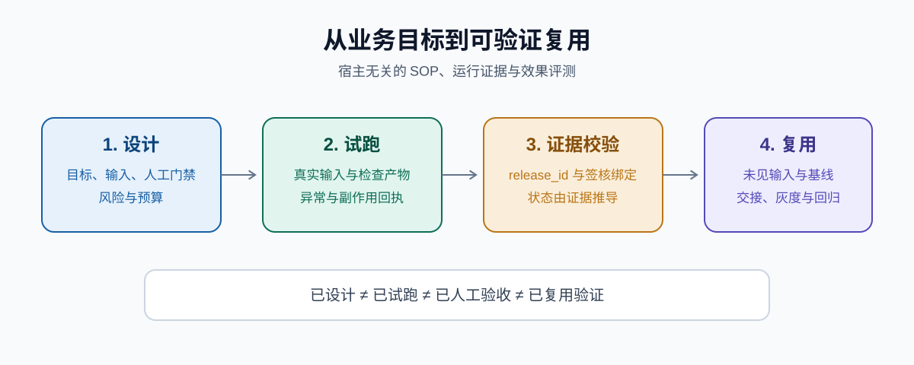

[English](README_en.md) | 简体中文

<div align="center">

# Agent Workflow Builder

**面向任何智能体的业务工作流搭建、执行、审计与复用 Skill：让结果可验收、风险可控制、证据可追溯。**

[](https://github.com/async-artisan/workflow-builder/actions/workflows/validate.yml)
[](https://github.com/async-artisan/workflow-builder/releases)
[](LICENSE)
[](https://www.python.org/)



</div>

> 最近更新：2026-10-27 ｜ 当前版本：v0.1.2。

## 目录

- [项目简介](#项目简介)
- [核心能力](#核心能力)
- [快速开始](#快速开始)
- [环境要求](#环境要求)
- [安装与接入](#安装与接入)
- [常用用法](#常用用法)
- [项目结构](#项目结构)
- [证据边界](#证据边界)
- [开发与回归](#开发与回归)
- [FAQ](#faq)
- [贡献与社区](#贡献与社区)
- [许可证](#许可证)

## 项目简介

`workflow-builder` 帮助智能体把重复业务任务转化为可执行、可检查、可恢复、可复用的工作流。它适用于需要流程设计、真实试跑、人工验收、异常恢复、效果评测或流程审计的用户。

核心采用 Markdown、开放 Agent Skills 目录结构和可选 Python 标准库脚本，**不绑定 Codex、Claude、WorkBuddy 或任何特定模型与平台**。没有脚本执行能力的宿主仍可使用其中的 SOP、风险控制和验收方法。

## 核心能力

- 设计、搭建、执行、审计四种请求路由，避免为一次性任务强行建流程。
- 模糊需求访谈、理解回放和输出样例确认；清晰用户可跳过访谈。
- 参数化 SOP 模板与 SOP → Agent Skill 生成器。
- 平台选择矩阵和可插拔适配器契约。
- 外部工具、MCP、API、CLI 与已有 Skill 的能力组合和降级指导。
- 运行清单、证据状态推导、副作用回执与恢复检查。
- 只读、可逆写入、受限写入的风险分级与预算停止。
- `release_id` 内容绑定、签核版本校验和依赖漂移检测。
- 基线、业务 oracle、通过阈值和单位验收成本评测方法。
- 人工意见、检查证据、签核记录及知识库维护方法。

## 快速开始

无需安装第三方 Python 包。克隆后运行只读合成示例，生成一个独立 Skill：

```bash
git clone https://github.com/async-artisan/workflow-builder.git
cd workflow-builder
python scripts/sop_to_skill.py examples/readonly-minutes/workflow.sop.md --check
python scripts/sop_to_skill.py examples/readonly-minutes/workflow.sop.md --output-dir build
```

成功后查看：

```text
build/readonly-minutes/SKILL.md
```

这只证明示例 SOP 可以校验并生成 Skill，不代表已经安装、加载或通过真实业务验收。

## 环境要求

| 项目 | 要求 | 是否必需 |
| --- | --- | --- |
| 智能体宿主 | 能读取 Markdown；完整渐进加载需支持 Agent Skills 或等效机制 | 必需 |
| Python | 3.9+，仅使用标准库 | 仅运行生成、发布绑定和校验工具时需要 |
| Node.js | 22.20+ | 仅通过 Skills CLI 安装时需要 |
| Git | 用于克隆和源码更新 | 仅源码安装时需要 |
| 操作系统 | 使用宿主支持的 Windows、macOS 或 Linux；CI 当前在 Ubuntu 上验证 | 按宿主环境 |

## 安装与接入

### 通过 Skills CLI 安装

在支持 Skills CLI 的项目中运行：

```bash
npx skills add async-artisan/workflow-builder
```

已验证该命令能够发现仓库中的 `workflow-builder`。按提示选择目标智能体和安装范围；Node.js 需为 22.20 或更高版本。参见 [Skills CLI 文档](https://github.com/vercel-labs/skills)。

跨宿主安装建议优先使用下方 Release ZIP，它只包含固定清单中的运行文件。Skills CLI 会依据仓库结构和目标宿主执行自己的筛选与安全检查；若源仓库安装触发额外提示，可改用精简包并先核对 SHA-256。各平台扫描规则不同，精简包也不能保证所有平台都不显示提示。

### 通过 Release ZIP 安装

从 [Releases](https://github.com/async-artisan/workflow-builder/releases) 下载 `workflow-builder-v0.1.2.zip`，解压后将 `workflow-builder` 目录放入下表对应的 Skills 目录。该安装包只含 Skill 指令、引用、模板、可选校验工具和许可证，不含示例、评测、测试或构建脚本。发布附件中的 SHA-256 文件可用于核验下载完整性；它不代表发布者身份验证。

### 构建 Codex / ChatGPT 插件包

本项目同时提供 Agent Plugins 1.0 清单和构建脚本，不需要 MCP：

```bash
python scripts/build_plugin.py --check
python scripts/build_plugin.py --format skill
python scripts/build_plugin.py
```

使用 `--format skill` 生成直接安装包；默认生成的 `dist/agent-workflow-builder-v0.1.2-plugin.zip` 在根目录包含 `plugin.json`，并将 Skill 放在 `skills/workflow-builder/`。两种包都使用固定运行文件清单，不包含开发用评测、测试和示例；构建器会拒绝符号链接及白名单外 ZIP 内容。本地检查仅验证包结构，不代表宿主安全审核通过或发布者身份验证。

### 支持 Agent Skills 的宿主

手动接入时，将 Release ZIP 内的 `workflow-builder` 目录复制、链接或导入宿主的 Skills 目录。不要用完整开发仓库代替安装包；仓库中的示例、评测和测试只用于维护验证：

| 宿主 | 用户级示例路径 |
| --- | --- |
| Codex | `~/.codex/skills/workflow-builder/` |
| Claude Code | `~/.claude/skills/workflow-builder/` |
| WorkBuddy | `~/.workbuddy/skills/workflow-builder/` |

其他智能体按各自的 Skill 发现或导入机制接入。`agents/openai.yaml` 只是可选的 OpenAI/Codex 展示适配，其他宿主可以忽略。

### 仅支持 Markdown 指令的宿主

将 `SKILL.md` 作为自定义指令、规则或系统提示的一部分，并按任务提供相关 `references/` 内容。无法自动读取链接资源时，需要手动附上对应文件。

### 接入失败排查

先确认 `SKILL.md` 位于技能目录根部，而非多套一层仓库目录；再检查宿主是否已重新扫描 Skills。若宿主不支持自动发现，直接显式提供 `SKILL.md` 内容。

## 常用用法

### 通过自然语言调用

```text
请使用 workflow-builder，帮我把这个重复业务任务搭建为可验证、可复用的工作流。
```

在 Codex 中可使用 `$workflow-builder`。也可以直接要求审计：

```text
请使用 workflow-builder，审计现有流程能否闭环，并给出有证据的问题清单。
```

需求还不清楚时可以直接说“我想自动化，但不知道从哪开始”。Skill 会先询问具体重复事务，再通过理解回放和输出样例确认首版；不会要求你先学会写流程或提示词。完整示例见 [模糊需求到可确认首版](examples/discovery/vague-to-mvp.md)，引导规范见 [需求发现访谈](references/discovery-interview.md)。

需要调用外部工具或其他 Skill 时，按 [工具与 Skill 能力编排](references/capability-composition.md) 复用现有能力、验证调用并设计降级；[软件测试组合示例](examples/software-testing/capability-plan.md) 展示文档、表格、浏览器和报告 Skill 如何协作。

### 从 SOP 生成 Skill

复制 `assets/sop.template.md` 并填写业务内容，然后执行：

```bash
python scripts/sop_to_skill.py /path/to/example.sop.md --check
python scripts/sop_to_skill.py /path/to/example.sop.md --output-dir /path/to/skills
```

`/path/to/` 需替换为实际路径。参数如下：

| 参数 | 含义 | 默认值 |
| --- | --- | --- |
| `--check` | 只校验 SOP，不写文件 | 关闭 |
| `--output-dir` | Skill 输出根目录 | 生成模式必填 |
| `--force` | 允许覆盖同名生成文件 | 关闭 |

格式规范见 [标准 SOP 与 Skill 生成](references/sop-format.md)。

### 绑定发布并校验运行证据

以下命令使用仓库内示例，可直接执行：

```bash
python scripts/build_release.py examples/readonly-minutes/workflow.sop.md examples/readonly-minutes/input.md examples/readonly-minutes/expected.md evals/cases/readonly-minutes.json --base-dir . --output build/release.json
python scripts/build_release.py --check build/release.json --base-dir .
```

实际运行时，将生成的 `release` 对象嵌入运行清单，再执行：

```bash
python scripts/validate_run.py /path/to/run.json --json
```

`/path/to/run.json` 需替换为已填写的运行清单；可从 `assets/run-manifest.template.json` 复制。校验器会拒绝无证据完成、旧发布签核、未知外部结果直接重试和预算超限等不一致状态。

## 项目结构

```text
workflow-builder/
├── SKILL.md
├── agents/openai.yaml          # 可选宿主适配
├── assets/                    # SOP、运行清单与签核模板
├── references/                # 方法、评测、风险、发布与平台规范
├── scripts/                   # 生成、发布绑定和证据校验工具
├── evals/                     # 触发测试与业务评测用例
├── examples/                  # 合成端到端示例
├── tests/                     # 正反向回归测试
├── docs/images/               # README 示意图
└── .github/workflows/         # 自动校验
```

## 证据边界

- “Skill 已生成”不等于已安装、已加载或已验证运行。
- `validate_run.py` 校验证据关联，不自动证明证据真实或审批人有权限。
- 合成 fixture 用于验证工具机制，不构成真实业务效果或跨宿主兼容性证据。
- “已复用验证”需要未见输入、实际基线和预先冻结的通过阈值。
- 沉默不视为批准，Agent 互审不替代人工业务验收。

## 开发与回归

```bash
python scripts/check_repository.py
python -m unittest discover -s tests -v
```

GitHub Actions 会检查结构、内部链接、JSON、Python 语法、SOP 生成和正反向工具用例。跨宿主触发与真实业务效果仍需在对应环境中单独验证。

## FAQ

### 这是 Codex 专用 Skill 吗？

不是。核心面向任何能读取 Markdown 的智能体。Codex、Claude Code 和 WorkBuddy 只是示例接入环境，`agents/openai.yaml` 也可被其他宿主忽略。

### 没有 Python 还能使用吗？

可以使用 SOP、平台适配、风险控制和验收签核方法。SOP 生成、发布绑定、运行清单校验及自动测试需要 Python 3.9+。

### SOP 校验通过，是否说明业务工作流可靠？

不说明。校验只证明结构有效；业务可靠性还需要真实输入、业务断言、异常验证、人工验收和不同输入复跑。

### 运行清单校验通过，是否说明证据一定真实？

不说明。工具检查状态与证据是否一致，原始证据、审批权限和外部系统状态仍需回读或向负责人核实。

### 如何升级源码安装的旧版本？

先备份自己修改的 SOP、模板和运行记录；在干净克隆中执行 `git pull`，再运行开发与回归命令。若宿主有技能缓存，更新后重新扫描或新建会话。

## 贡献与社区

欢迎通过 [GitHub Issues](https://github.com/async-artisan/workflow-builder/issues) 报告问题、讨论需求或分享真实评测结果，也欢迎提交 [Pull Requests](https://github.com/async-artisan/workflow-builder/pulls)。提交前请运行“开发与回归”中的两条命令；涉及验证逻辑时同时补充正向和反向测试。

## 许可证

本项目基于 [MIT License](LICENSE) 发布。使用、修改和再分发时需保留原版权及许可证声明；软件按“原样”提供，不附带明示或默示担保。
